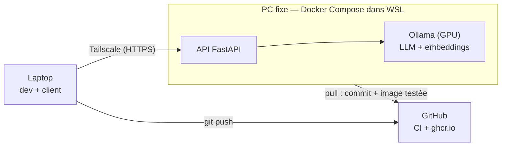

# RAG local


Assistant de questions-réponses sur des documents PDF et une base PostgreSQL, entièrement
auto-hébergé : modèles, base vectorielle et API tournent sur une machine personnelle,
interrogée à distance via un réseau privé.

> Projet en construction, phase par phase. Phase actuelle : serveurs de modèles (Ollama sur GPU).

## Architecture



| Brique | Choix | Pourquoi |
|---|---|---|
| API | FastAPI (async) | plusieurs questions servies en parallèle |
| Réseau | Tailscale + `tailscale serve` | aucun port ouvert sur la box, HTTPS automatique |
| Modèles | Ollama sur GPU : `mistral-small3.2:24b`, `gemma4:12b`, `bge-m3` (embeddings) | l'API passe par l'interface compatible OpenAI : changer de serveur (vLLM) ou de fournisseur ne demande que des variables d'environnement |
| CI | GitHub Actions | lint (ruff), puis une seule image construite, testée (pytest, démarrage) et publiée |
| CD | déploiement « pull » | le repo est public : aucun code venu de GitHub ne s'exécute sur la machine hôte, elle récupère seulement l'image validée par la CI, et revient seule à la version précédente si la nouvelle ne démarre pas |

## Lancer en local

Prérequis : Docker.

```bash
git clone https://github.com/messine-7/rag-local.git
cd rag-local
docker compose up -d --build --wait api
curl http://localhost:8000/health
```

Seule l'API démarre. `docker compose up -d ollama` ajoute le serveur de modèles ; sans GPU,
il tourne sur le CPU (lent, plutôt pour de petits modèles).

## API

| Endpoint | Rôle |
|---|---|
| `GET /health` | état et commit déployé (`version`) |
| `POST /llm/generate` | génère une réponse à un prompt (`prompt`, `model`, `max_tokens`) — phase 3, remplacé par `/ask` en phase 5 |
| `POST /llm/embed` | embeddings d'une liste de textes (`texts`) — phase 3 |

Documentation interactive : `/docs`.

## Développer

```bash
python -m venv .venv
# Windows : .venv\Scripts\activate   —   Linux : source .venv/bin/activate
pip install -r requirements-dev.txt
ruff check . && ruff format --check . && pytest
```

## Déploiement

1. Chaque push sur `main` lance la CI sur les runners GitHub : lint, build de l'image une
   seule fois, tests pytest dans un conteneur créé à partir de cette image, puis test de
   démarrage (`/health` doit répondre).
2. Si tout passe, cette même image est publiée sur `ghcr.io/messine-7/rag-local-api`, taguée avec le commit.
3. Sur la machine hôte (Windows + Docker dans WSL), un timer systemd lance `deploy/pull-deploy.sh`
   toutes les 2 minutes. Dès que l'image du dernier commit existe, le script met à jour le clone
   et relance les conteneurs ; sinon il ne touche à rien.
4. Si la nouvelle version ne démarre pas, le script relance la précédente. Il ne garde que
   l'image en service et la précédente, pour libérer le disque.

`GET /health` renvoie le commit déployé dans le champ `version`.

## Modèles (machine hôte)

Téléchargés une seule fois dans le volume `ollama`, ils survivent aux déploiements :

```bash
bash deploy/compose.sh exec ollama ollama pull mistral-small3.2:24b
bash deploy/compose.sh exec ollama ollama pull gemma4:12b
bash deploy/compose.sh exec ollama ollama pull bge-m3
bash deploy/compose.sh exec ollama ollama ps    # après une requête : « 100% GPU » attendu
```

Réglages (modèles, requêtes en parallèle, taille du contexte) : copier `.env.example` en `.env`,
l'ajuster, puis `bash deploy/compose.sh up -d ollama api`.

## Mesurer

Latence et débit à 1, 4 et 8 requêtes simultanées, depuis n'importe quelle machine qui joint
l'API (aucune dépendance) :

```bash
python scripts/bench_llm.py --url https://<machine-hôte> --model mistral-small3.2:24b --model gemma4:12b
```

## Structure

| Dossier | Rôle |
|---|---|
| `api/` | API FastAPI |
| `worker/` | ingestion PDF (à venir) |
| `client/` | client en ligne de commande (à venir) |
| `tests/` | tests pytest |
| `deploy/` | déploiement pull sur la machine hôte (`install-timer.sh` l'installe, `compose.sh` pour l'exploitation) |
| `scripts/` | outils (benchmark du serveur de modèles) |
| `.github/workflows/` | CI et publication de l'image |
