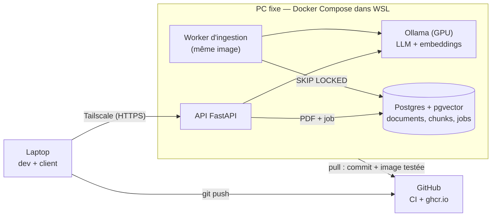

# RAG local


Assistant de questions-réponses sur des documents PDF et une base PostgreSQL, entièrement
auto-hébergé : modèles, base vectorielle et API tournent sur une machine personnelle,
interrogée à distance via un réseau privé.

> Projet en construction, phase par phase. Phase actuelle : questions, conversations, connexion
> et gouvernance (phase 5). Phases précédentes : ingestion des PDF (Postgres + pgvector, worker),
> serveurs de modèles (Ollama sur GPU) — voir [Mesurer](#mesurer).

## Architecture



| Brique | Choix | Pourquoi |
|---|---|---|
| API | FastAPI (async) | plusieurs questions servies en parallèle |
| Réseau | Tailscale + `tailscale serve` | aucun port ouvert sur la box, HTTPS automatique |
| Base | Postgres 17 + pgvector (HNSW) | vecteurs, plein texte et file de jobs dans un seul service à opérer et sauvegarder |
| Ingestion | worker séparé, PyMuPDF | les PDF sont traités hors de l'API : l'indexation ne ralentit pas les questions |
| Modèles | Ollama sur GPU : `mistral-small3.2:24b`, `gemma4:12b`, `bge-m3` (embeddings) | l'API passe par l'interface compatible OpenAI : changer de serveur (vLLM) ou de fournisseur ne demande que des variables d'environnement |
| CI | GitHub Actions | lint (ruff), puis une seule image construite, testée (pytest, démarrage) et publiée |
| CD | déploiement « pull » | le repo est public : aucun code venu de GitHub ne s'exécute sur la machine hôte, elle récupère seulement l'image validée par la CI, et revient seule à la version précédente si la nouvelle ne démarre pas |

## Lancer en local

Prérequis : Docker.

```bash
git clone https://github.com/messine-7/rag-local.git
cd rag-local
docker compose up -d --build --wait api worker
curl http://localhost:8000/health
```

L'API, le worker et Postgres démarrent. `docker compose up -d ollama` ajoute le serveur de
modèles (nécessaire au worker pour les embeddings, `bge-m3` à télécharger) ; sans GPU, il tourne
sur le CPU (lent, plutôt pour de petits modèles).

## API

| Endpoint | Rôle |
|---|---|
| `GET /health` | état et commit déployé (`version`) — seule route sans connexion |
| `POST /auth/login` | nom + mot de passe → jeton de session (7 jours, `SESSION_TTL_HOURS`) |
| `POST /auth/logout` | révoque le jeton utilisé |
| `GET /auth/me` | l'utilisateur du jeton |
| `POST /auth/api-keys` | crée une clé API personnelle (`name`), sans expiration ; valeur montrée une seule fois |
| `GET /auth/api-keys` / `DELETE /auth/api-keys/{id}` | liste ou révoque ses clés API |
| `POST /llm/generate` | génère une réponse à un prompt (`prompt`, `model`, `max_tokens`) — phase 3, remplacé par `/ask` en phase 5 |
| `POST /llm/embed` | embeddings d'une liste de textes (`texts`) — phase 3 |
| `POST /documents` | envoie un PDF à indexer (multipart, champs `file` et `collection`, `défaut` sinon) ; 202 : mis dans la file, 200 : déjà indexé ; droit d'écriture requis |
| `GET /documents` | documents des collections accessibles, et état de leur ingestion |
| `GET /collections` | collections accessibles, avec son droit (`read` ou `write`) |
| `POST /ask` | question sur les documents accessibles (`question`, `conversation_id`, `model`, `collections`, `stream`) ; réponse en SSE avec citations `[n]` |
| `GET /conversations` / `GET /conversations/{id}` / `DELETE …` | ses conversations, une conversation avec ses messages, suppression |
| `/admin/users`, `/admin/collections`, `/admin/groups…` | administration, réservée aux admins (voir « Gouvernance ») |
| `GET /admin/access-log` | journal d'accès, réservé aux admins (voir « Journal d'accès ») |
| `GET /documents/{id}` | état d'un document : `pending` → `processing` → `ready`, ou `failed` avec `error` |

Documentation interactive : `/docs` (bouton « Authorize » pour y coller un jeton).

```bash
TOKEN=rag_k_...   # clé API, ou jeton renvoyé par POST /auth/login
curl -H "Authorization: Bearer $TOKEN" -F "file=@rapport.pdf" https://<machine-hôte>/documents
curl -H "Authorization: Bearer $TOKEN" https://<machine-hôte>/documents/1
```

## Connexion

Toutes les routes sauf `/health` exigent `Authorization: Bearer <jeton>`, sinon 401. Deux
sortes de jetons, stockés en base sous leur seule empreinte SHA-256 :

- **jeton de session** (`rag_s_…`) : `POST /auth/login`, pour une interface ; expire ;
- **clé API** (`rag_k_…`) : `POST /auth/api-keys`, pour le CLI et les scripts ; valable
  jusqu'à révocation.

Mots de passe hachés avec argon2. Pas d'inscription : les comptes se créent en ligne de
commande, dans le conteneur de l'API (mot de passe demandé, jamais en argument) :

```bash
bash deploy/compose.sh exec api python -m app.admin create-user lucas --admin
bash deploy/compose.sh exec api python -m app.admin create-api-key lucas --name laptop
bash deploy/compose.sh exec api python -m app.admin list-users   # aussi : set-password, disable-user, enable-user
```

Changer un mot de passe ferme les sessions ouvertes ; désactiver un compte invalide tous ses
jetons. Les documents gardent l'utilisateur qui les a envoyés (`uploaded_by`).

## Questions

`POST /ask` :

1. conversation reprise (`conversation_id`) ou créée, question enregistrée ;
2. **question de suivi reformulée** : « Et pour 2025 ? » ne se comprend qu'avec la
   conversation ; le modèle la réécrit d'abord en question autonome (température 0, même
   modèle que la réponse sauf `ASK_REWRITE_MODEL`). Elle ne sert qu'à la recherche, le modèle
   répond à la question d'origine ; elle est renvoyée (`search_query`) et gardée avec la
   question. En cas d'échec, la recherche se fait sur la question d'origine.
   `ASK_REWRITE=false` désactive l'étape ;
3. **recherche hybride** parmi les chunks que l'appelant peut lire (RLS) : distance cosinus
   sur les embeddings (HNSW, `hnsw.iterative_scan` pour ne pas perdre de résultats avec le
   filtre des droits) et plein texte en français, fusionnés par Reciprocal Rank Fusion ;
   6 passages retenus (`ASK_TOP_K`) ;
4. prompt : consignes (répondre seulement d'après les extraits, citer `[n]`), extraits
   numérotés, 6 derniers messages de la conversation, question ;
5. réponse en **Server-Sent Events** : `meta` (conversation, modèle, question reformulée, citations), `token`
   (morceaux de texte), `done` (id du message, tokens, durée) ou `error`. Enregistrée avec
   ses citations à la fin du flux. `"stream": false` : une seule réponse JSON.

Aucun passage accessible : réponse « aucun passage pertinent », sans appeler le modèle.
Chacun ne voit que ses conversations, admins compris (RLS).

```bash
curl -N -H "Authorization: Bearer $TOKEN" -H "Content-Type: application/json" \
  -d '{"question": "Quel est le ROI ?", "model": "gemma4:12b"}' https://<machine-hôte>/ask
```

## Gouvernance

Les documents sont rangés en **collections**. Les utilisateurs sont réunis en **groupes**, et
chaque groupe a un droit sur des collections : `read` (lister, interroger) ou `write` (en plus,
envoyer des PDF). Un admin a tous les droits ; un utilisateur sans groupe ne voit rien.

Ces droits sont appliqués **par Postgres** (Row-Level Security, migration
[004_governance.sql](api/app/migrations/004_governance.sql)), pas seulement par le code :

- l'API sert les requêtes avec le rôle `rag_api`, ni super-utilisateur ni `BYPASSRLS` (elle
  refuse de démarrer sinon) ; le propriétaire `rag` ne sert qu'aux migrations, au worker et
  à `app.admin` ;
- chaque requête tourne dans une transaction où l'API place l'**empreinte du jeton** reçu
  (`app.token_hash`) ; Postgres en déduit l'utilisateur et ses collections. `rag_api` ne peut
  pas lire les empreintes des jetons : une injection SQL ne peut pas se faire passer pour un
  autre utilisateur ;
- documents, chunks et collections sont filtrés ; groupes, droits et comptes ne sont
  modifiables que par un admin, même en SQL direct.

Administration (admin, depuis `/docs` ou en HTTP) :

```bash
POST   /admin/collections                      {"name": "rh"}
POST   /admin/groups                           {"name": "équipe-rh"}
PUT    /admin/groups/{id}/members/{user_id}
PUT    /admin/groups/{id}/collections/{coll}   {"permission": "read"}   # ou "write"
DELETE /admin/groups/{id}/members/{user_id}    # et …/collections/{coll}
POST   /admin/users                            {"username": "bob", "password": "…"}
PATCH  /admin/users/{id}                       {"is_admin": true} / {"disabled": true}
```

`API_DB_PASSWORD` (`.env`, obligatoire sur la machine hôte) : mot de passe de `rag_api`,
reposé à chaque démarrage de l'API.

### Journal d'accès

Table `access_log` ([007_access_log.sql](api/app/migrations/007_access_log.sql)) : une ligne
par question, connexion (réussie ou non), déconnexion, clé API créée ou révoquée, PDF envoyé
et action d'administration (API ou `app.admin`), avec l'utilisateur, le jeton utilisé et
l'adresse de l'appelant.

- **Métadonnées seulement** : pour une question, le modèle, les collections, documents et
  chunks lus, et si elle a été reformulée, jamais son texte ni la réponse. Les conversations
  restent privées, admins compris. Ni mot de passe ni jeton.
- Écrite dans la même transaction que l'action : pas d'action sans trace.
- **Ajout seul** : `rag_api` peut écrire, pas modifier ni effacer ; chacun n'écrit qu'à son
  nom (RLS). Le journal survit à la suppression d'une conversation.
- Lecture réservée aux admins :

```bash
GET /admin/access-log?user_id=3&action=ask&since=2026-11-01T00:00:00Z&limit=100
GET /admin/access-log?document_id=12           # qui a interrogé le document 12
GET /admin/access-log?before_id=<plus petit id reçu>   # page suivante
```

## Consulter la base (DBeaver)

Sur la machine hôte, Postgres est publié sur `127.0.0.1:5433` seulement, et relayé dans le
tailnet. Compte Postgres en **lecture seule** (rôle `rag_readonly` : lecture de toutes les
tables, sauf les empreintes de jetons et les hachages de mots de passe ; aucune écriture).
Une fois, sur la machine hôte :

```bash
bash deploy/compose.sh exec api python -m app.admin create-db-reader dbeaver   # mot de passe demandé
```

```powershell
tailscale serve --bg --tcp=5433 tcp://127.0.0.1:5433    # Windows, PowerShell
```

DBeaver : hôte `<machine-hôte>.<tailnet>.ts.net`, port `5433`, base `rag`, utilisateur
`dbeaver`. Relancer `create-db-reader` sur le même nom change son mot de passe.

## Ingestion des PDF

1. `POST /documents` range le PDF dans le volume `uploads` sous son empreinte SHA-256 (le même
   fichier n'est jamais indexé deux fois), crée le document et un job dans la table `jobs`.
2. Le worker (`python -m app.worker`, même image que l'API) prend le plus ancien job avec
   `SELECT … FOR UPDATE SKIP LOCKED` : plusieurs workers peuvent tourner sans se marcher dessus.
   File vide : il regarde de nouveau toutes les 3 s.
3. Texte extrait page par page (PyMuPDF), découpé en chunks d'environ 1 500 caractères avec
   200 de chevauchement, sans franchir de page (pour citer la page), puis vectorisé par lots
   avec `bge-m3`.
4. Chunks insérés en une seule transaction, avec le nom du modèle d'embeddings ; le document
   passe à `ready`.

En cas d'échec : PDF illisible ou sans texte (scanné : pas d'OCR) → `failed` tout de suite ;
erreur temporaire (Ollama indisponible) → nouvel essai après 1 puis 2 minutes, `failed` au
3ᵉ échec. Renvoyer un PDF en échec le remet dans la file. Un job resté `running` plus de
15 minutes (worker arrêté net) est remis dans la file.

Schéma : [api/app/migrations/](api/app/migrations/), fichiers SQL appliqués dans l'ordre au
démarrage de l'API et du worker (table `schema_migrations`). Une migration appliquée ne se
modifie plus : tout changement passe par un nouveau fichier.

## Développer

Les dépendances Python sont gérées avec [uv](https://docs.astral.sh/uv/) : `pyproject.toml`
les déclare, `uv.lock` fige les versions exactes. Ces deux fichiers servent partout : poste de
dev, image Docker (`uv sync --frozen --no-dev`) et tests en CI. Il n'y a pas de
`requirements.txt`.

### Installer uv (une fois par machine)

```bash
# Windows (PowerShell)
powershell -ExecutionPolicy ByPass -c "irm https://astral.sh/uv/install.ps1 | iex"
# Linux / WSL / macOS
curl -LsSf https://astral.sh/uv/install.sh | sh
```

### Préparer l'environnement

```bash
uv sync
```

`uv sync` télécharge Python 3.12 si besoin (version fixée par `.python-version`), crée `.venv/`
et y installe exactement les versions de `uv.lock` : dépendances de l'API, plus le groupe `dev`
(pytest, httpx, ruff). Pas besoin d'activer le venv : `uv run` l'utilise directement.

### Vérifier avant de pousser

```bash
uv run ruff check .
uv run ruff format --check .
uv run pytest
```

Les tests de l'ingestion ont besoin de Postgres + pgvector ; sans `TEST_DATABASE_URL`, ils
sont ignorés (la CI lance son propre Postgres). En local, ils utilisent la base `rag_test` du
Postgres de dev : `compose.override.yml` (lu par `docker compose` sur le poste de dev, jamais
par le PC fixe) publie le port sur `127.0.0.1:5433` et crée `rag_test` au premier démarrage.
Ajouter dans `.env` (même mot de passe que `POSTGRES_PASSWORD`) :

```bash
TEST_DATABASE_URL=postgresql://rag:<POSTGRES_PASSWORD>@127.0.0.1:5433/rag_test
```

puis `docker compose up -d db` et `uv run pytest`. Les tests vident la base : ils refusent
de tourner si son nom ne finit pas par `_test`. Volume `pgdata` créé avant
`compose.override.yml` : `docker compose exec db createdb -U rag rag_test`.

Les tests n'appellent jamais Ollama (modèles remplacés par des faux). Pour essayer la stack
sur le laptop, l'API et le worker utilisent l'Ollama du PC fixe (GPU) : `compose.override.yml`
ne démarre pas d'Ollama local, et `.env` contient
`LLM_BASE_URL=https://pc-fixe.<tailnet>.ts.net:11434/v1`. Sur le PC fixe, une seule fois,
après un déploiement qui publie `127.0.0.1:11434` (`deploy/compose.prod.yml`) :

```powershell
tailscale serve --bg --https=11434 http://127.0.0.1:11434
```

### Ajouter ou mettre à jour une dépendance

```bash
uv add "fastapi>=0.115"             # dépendance de l'API (image Docker)
uv add --group test "pytest-asyncio" # outil de test (installé en CI)
uv add --group dev "mypy"           # outil du poste de dev seulement
uv lock --upgrade-package openai    # monter une version dans les bornes de pyproject.toml
```

Committer `pyproject.toml` et `uv.lock` ensemble. La CI échoue si `uv.lock` ne correspond
plus à `pyproject.toml` (`uv lock --locked`).

| Fichier | Rôle | Modifié par |
|---|---|---|
| `pyproject.toml` | dépendances déclarées (bornes), groupes `test` et `dev`, version d'uv imposée | `uv add` / `uv remove` |
| `uv.lock` | versions exactes de toutes les dépendances, pour toutes les plateformes | `uv lock`, `uv add` |
| `.python-version` | version de Python du poste de dev (celle de l'image : 3.12) | `uv python pin` |

### Version d'uv

`pyproject.toml` impose une version d'uv (`required-version`), lue aussi par la CI ; l'image
copie la même depuis `ghcr.io/astral-sh/uv` (`api/Dockerfile`). Pour en changer : modifier les
deux, puis `uv self update` sur le poste de dev.

### Construire l'image à la main

Le contexte de build est la racine du repo (pour `pyproject.toml` et `uv.lock`) ; les fichiers
envoyés sont listés dans `api/Dockerfile.dockerignore`.

```bash
docker build -f api/Dockerfile -t rag-local-api .
```

## Déploiement

1. Chaque push sur `main` lance la CI sur les runners GitHub : lint, build de l'image une
   seule fois, tests pytest dans un conteneur créé à partir de cette image (avec un Postgres +
   pgvector jetable), puis test de démarrage (`/health` doit répondre, le worker doit tenir).
2. Si tout passe, cette même image est publiée sur `ghcr.io/messine-7/rag-local-api`, taguée
   avec le commit. L'API et le worker tournent tous deux avec cette image.
3. Sur la machine hôte (Windows + Docker dans WSL), un timer systemd lance `deploy/pull-deploy.sh`
   toutes les 2 minutes. Dès que l'image du dernier commit existe, le script met à jour le clone
   et relance les conteneurs ; sinon il ne touche à rien.
4. Si la nouvelle version ne démarre pas, le script relance la précédente. Il ne garde que
   l'image en service et la précédente, pour libérer le disque.

`GET /health` renvoie le commit déployé dans le champ `version`.

## Modèles (machine hôte)

Téléchargés une seule fois dans le volume `ollama`, ils survivent aux déploiements :

```bash
bash deploy/compose.sh exec ollama ollama pull mistral-small3.2:24b
bash deploy/compose.sh exec ollama ollama pull gemma4:12b
bash deploy/compose.sh exec ollama ollama pull bge-m3
bash deploy/compose.sh exec ollama ollama ps    # après une requête : « 100% GPU » attendu
```

Réglages (modèles, requêtes en parallèle, taille du contexte) : copier `.env.example` en `.env`,
l'ajuster, puis `bash deploy/compose.sh up -d ollama api worker`. Fixer `POSTGRES_PASSWORD`
avant le premier démarrage de la base : il est écrit dans le volume à sa création.

## Mesurer

Latence et débit à 1, 4 et 8 requêtes simultanées, depuis n'importe quelle machine qui joint
l'API (aucune dépendance ; clé API dans `RAG_TOKEN` ou `--token`) :

```bash
RAG_TOKEN=rag_k_... uv run scripts/bench_llm.py --url https://<machine-hôte> --model mistral-small3.2:24b --model gemma4:12b
```

Sous Windows PowerShell 5.1, pour un affichage correct des accents et un fichier en UTF-8 :
`$env:PYTHONUTF8 = 1` avant la commande, et `| Out-File -Encoding utf8 bench.md` plutôt que
`Tee-Object` (qui écrit en UTF-16).

Directement contre Ollama, sans l'API, en streaming : mesure aussi le temps avant le premier
mot et sépare réponse et raisonnement (modèles à raisonnement comme gemma4) :

```bash
uv run scripts/bench_ollama.py --url https://<machine-hôte>:11434/v1 --model mistral-small3.2:24b --model gemma4:12b
```

Résultats sur RTX 3090 (24 Go), Ollama, `OLLAMA_NUM_PARALLEL=4`, réponses de 256 tokens,
`reasoning_effort: "none"` — détail et analyse dans
[docs/benchmarks/2026-11-25-ollama.md](docs/benchmarks/2026-11-25-ollama.md) :

| Modèle | Concurrence | Latence p50 (s) | 1er mot p50 (s) | Débit par requête (tok/s) | Débit total (tok/s) |
|---|---|---|---|---|---|
| mistral-small3.2:24b | 1 / 4 / 8 | 5.1 / 8.5 / 15.9 | 0.08 / 0.26 / 8.0 | 50 / 30 / 20 | 50 / 120 / 128 |
| gemma4:12b | 1 / 4 / 8 | 2.5 / 3.8 / 7.9 | 0.12 / 0.27 / 4.2 | 100 / 66 / 39 | 100 / 261 / 247 |

Sans `reasoning_effort: "none"`, gemma4 n'écrit aucun mot : ses 256 tokens partent en
raisonnement invisible (c'est ce qu'a mesuré, à tort, le benchmark du 2026-11-18). Au-delà de
4 requêtes simultanées, le débit plafonne (`NUM_PARALLEL`) et les suivantes attendent leur
tour sans rien recevoir : 4 à 8 s avant le premier mot.

## Structure

| Dossier | Rôle |
|---|---|
| `api/` | code Python de l'image : API FastAPI, worker d'ingestion (`app/worker.py`), migrations SQL |
| `client/` | client en ligne de commande (à venir) |
| `tests/` | tests pytest |
| `deploy/` | déploiement pull sur la machine hôte (`install-timer.sh` l'installe, `compose.sh` pour l'exploitation) |
| `scripts/` | outils (benchmark du serveur de modèles) |
| `docs/` | résultats de mesures (`benchmarks/`) |
| `.github/workflows/` | CI et publication de l'image |
