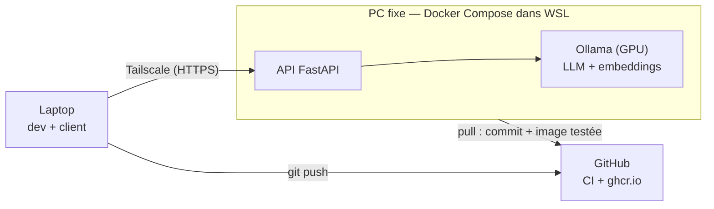

# RAG local


Assistant de questions-réponses sur des documents PDF et une base PostgreSQL, entièrement
auto-hébergé : modèles, base vectorielle et API tournent sur une machine personnelle,
interrogée à distance via un réseau privé.

> Projet en construction, phase par phase. Phase actuelle : serveurs de modèles (Ollama sur GPU).

## Architecture



| Brique | Choix | Pourquoi |
|---|---|---|
| API | FastAPI (async) | plusieurs questions servies en parallèle |
| Réseau | Tailscale + `tailscale serve` | aucun port ouvert sur la box, HTTPS automatique |
| Modèles | Ollama sur GPU : `mistral-small3.2:24b`, `gemma4:12b`, `bge-m3` (embeddings) | l'API passe par l'interface compatible OpenAI : changer de serveur (vLLM) ou de fournisseur ne demande que des variables d'environnement |
| CI | GitHub Actions | lint (ruff), puis une seule image construite, testée (pytest, démarrage) et publiée |
| CD | déploiement « pull » | le repo est public : aucun code venu de GitHub ne s'exécute sur la machine hôte, elle récupère seulement l'image validée par la CI, et revient seule à la version précédente si la nouvelle ne démarre pas |

## Lancer en local

Prérequis : Docker.

```bash
git clone https://github.com/messine-7/rag-local.git
cd rag-local
docker compose up -d --build --wait api
curl http://localhost:8000/health
```

Seule l'API démarre. `docker compose up -d ollama` ajoute le serveur de modèles ; sans GPU,
il tourne sur le CPU (lent, plutôt pour de petits modèles).

## API

| Endpoint | Rôle |
|---|---|
| `GET /health` | état et commit déployé (`version`) |
| `POST /llm/generate` | génère une réponse à un prompt (`prompt`, `model`, `max_tokens`) — phase 3, remplacé par `/ask` en phase 5 |
| `POST /llm/embed` | embeddings d'une liste de textes (`texts`) — phase 3 |

Documentation interactive : `/docs`.

## Développer

Les dépendances Python sont gérées avec [uv](https://docs.astral.sh/uv/) : `pyproject.toml`
les déclare, `uv.lock` fige les versions exactes. Ces deux fichiers servent partout : poste de
dev, image Docker (`uv sync --frozen --no-dev`) et tests en CI. Il n'y a pas de
`requirements.txt`.

### Installer uv (une fois par machine)

```bash
# Windows (PowerShell)
powershell -ExecutionPolicy ByPass -c "irm https://astral.sh/uv/install.ps1 | iex"
# Linux / WSL / macOS
curl -LsSf https://astral.sh/uv/install.sh | sh
```

### Préparer l'environnement

```bash
uv sync
```

`uv sync` télécharge Python 3.12 si besoin (version fixée par `.python-version`), crée `.venv/`
et y installe exactement les versions de `uv.lock` : dépendances de l'API, plus le groupe `dev`
(pytest, httpx, ruff). Pas besoin d'activer le venv : `uv run` l'utilise directement.

### Vérifier avant de pousser

```bash
uv run ruff check .
uv run ruff format --check .
uv run pytest
```

### Ajouter ou mettre à jour une dépendance

```bash
uv add "fastapi>=0.115"             # dépendance de l'API (image Docker)
uv add --group test "pytest-asyncio" # outil de test (installé en CI)
uv add --group dev "mypy"           # outil du poste de dev seulement
uv lock --upgrade-package openai    # monter une version dans les bornes de pyproject.toml
```

Committer `pyproject.toml` et `uv.lock` ensemble. La CI échoue si `uv.lock` ne correspond
plus à `pyproject.toml` (`uv lock --locked`).

| Fichier | Rôle | Modifié par |
|---|---|---|
| `pyproject.toml` | dépendances déclarées (bornes), groupes `test` et `dev`, version d'uv imposée | `uv add` / `uv remove` |
| `uv.lock` | versions exactes de toutes les dépendances, pour toutes les plateformes | `uv lock`, `uv add` |
| `.python-version` | version de Python du poste de dev (celle de l'image : 3.12) | `uv python pin` |

### Version d'uv

`pyproject.toml` impose une version d'uv (`required-version`), lue aussi par la CI ; l'image
copie la même depuis `ghcr.io/astral-sh/uv` (`api/Dockerfile`). Pour en changer : modifier les
deux, puis `uv self update` sur le poste de dev.

### Construire l'image à la main

Le contexte de build est la racine du repo (pour `pyproject.toml` et `uv.lock`) ; les fichiers
envoyés sont listés dans `api/Dockerfile.dockerignore`.

```bash
docker build -f api/Dockerfile -t rag-local-api .
```

## Déploiement

1. Chaque push sur `main` lance la CI sur les runners GitHub : lint, build de l'image une
   seule fois, tests pytest dans un conteneur créé à partir de cette image, puis test de
   démarrage (`/health` doit répondre).
2. Si tout passe, cette même image est publiée sur `ghcr.io/messine-7/rag-local-api`, taguée avec le commit.
3. Sur la machine hôte (Windows + Docker dans WSL), un timer systemd lance `deploy/pull-deploy.sh`
   toutes les 2 minutes. Dès que l'image du dernier commit existe, le script met à jour le clone
   et relance les conteneurs ; sinon il ne touche à rien.
4. Si la nouvelle version ne démarre pas, le script relance la précédente. Il ne garde que
   l'image en service et la précédente, pour libérer le disque.

`GET /health` renvoie le commit déployé dans le champ `version`.

## Modèles (machine hôte)

Téléchargés une seule fois dans le volume `ollama`, ils survivent aux déploiements :

```bash
bash deploy/compose.sh exec ollama ollama pull mistral-small3.2:24b
bash deploy/compose.sh exec ollama ollama pull gemma4:12b
bash deploy/compose.sh exec ollama ollama pull bge-m3
bash deploy/compose.sh exec ollama ollama ps    # après une requête : « 100% GPU » attendu
```

Réglages (modèles, requêtes en parallèle, taille du contexte) : copier `.env.example` en `.env`,
l'ajuster, puis `bash deploy/compose.sh up -d ollama api`.

## Mesurer

Latence et débit à 1, 4 et 8 requêtes simultanées, depuis n'importe quelle machine qui joint
l'API (aucune dépendance) :

```bash
python scripts/bench_llm.py --url https://<machine-hôte> --model mistral-small3.2:24b --model gemma4:12b
```

## Structure

| Dossier | Rôle |
|---|---|
| `api/` | API FastAPI |
| `worker/` | ingestion PDF (à venir) |
| `client/` | client en ligne de commande (à venir) |
| `tests/` | tests pytest |
| `deploy/` | déploiement pull sur la machine hôte (`install-timer.sh` l'installe, `compose.sh` pour l'exploitation) |
| `scripts/` | outils (benchmark du serveur de modèles) |
| `.github/workflows/` | CI et publication de l'image |
